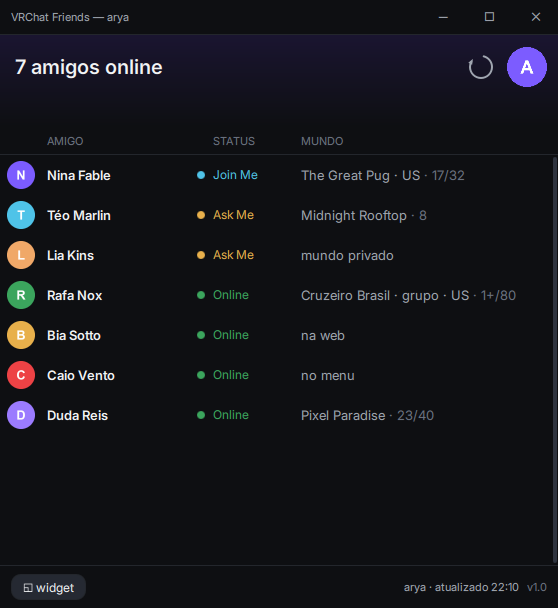
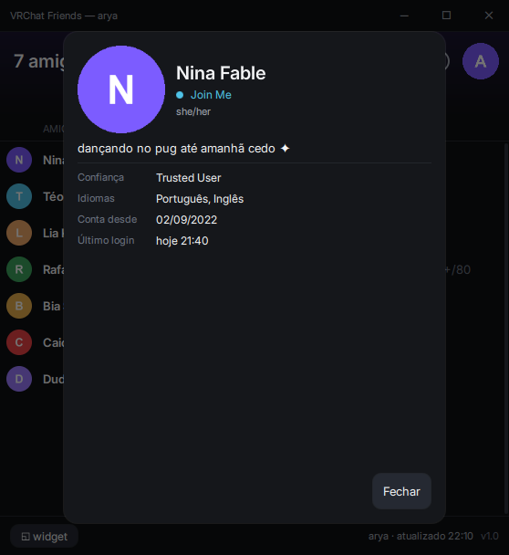
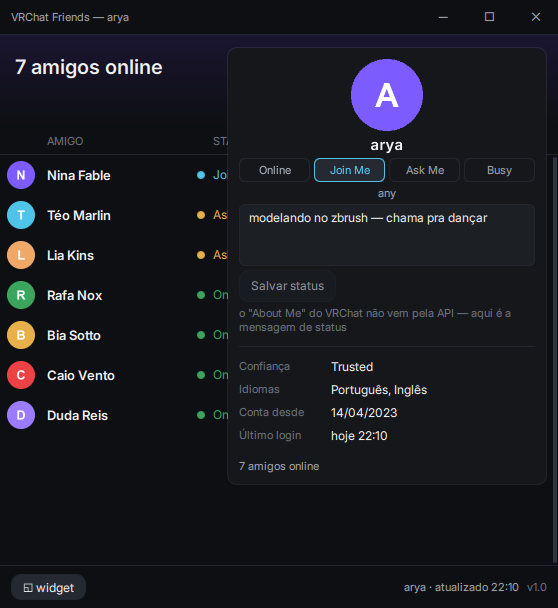
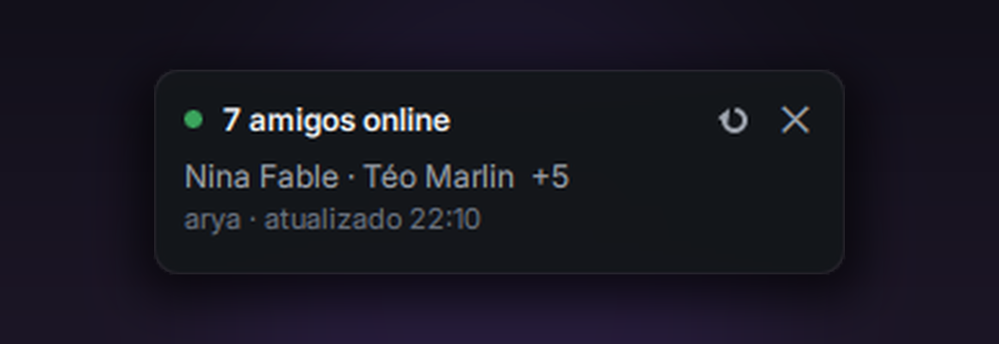

# VRChat Friends

Aplicativo de desktop leve (Windows) para ver **quais amigos estão online no VRChat** sem
manter o site aberto no navegador. Interface em Qt Quick (QML), com widget flutuante
opcional que fica sempre no topo.

*Lightweight Windows desktop app to see which VRChat friends are online, built with Qt Quick
(QML). Portuguese UI.*



## O que faz

- Lista só quem está online, ordenada por status (Join Me → Ask Me → Online → Busy) e nome.
- Avatar redondo de cada amigo, plataforma, mundo e **lotação da instância** quando a API informa.
- Botão de atualizar com animação; a lista se atualiza sozinha a cada 45 s.
- Clique no amigo: cartão com perfil completo (mensagem de status, pronomes, confiança,
  idiomas, datas).
- Painel do seu perfil: status (`Online / Join Me / Ask Me / Busy`) e mensagem de status
  **editáveis no VRChat**, direto do app.
- Widget flutuante compacto e sempre no topo, no estilo do mini player do Spotify.
- Fecha para a bandeja; o ícone da bandeja traz a janela de volta.

## Telas

| | |
|---|---|
|  |  |
| **Lista** — só quem está online, com a lotação da instância | **Amigo** — status, pronomes, confiança, idiomas, datas |
|  |  |
| **Meu perfil** — status e mensagem de status editáveis | **Widget** — compacto, sempre no topo |

As imagens são geradas por `screenshots.py` com dados fictícios (avatares inclusive): nenhum
amigo real aparece no repositório.

## Stack

| Camada | O que é |
|---|---|
| Núcleo | Python puro (`core/`), sem import de toolkit |
| Interface | PySide6 / Qt 6 (QtQuick + QtQuick Controls, estilo `Basic`) |
| HTTP | `requests` — API do VRChat (`api.vrchat.cloud/api/1`) |
| Imagens | `Pillow` (avatar redondo, cache em disco) |
| Empacotamento | PyInstaller (build em diretório, sem console) |

## Rodar do código

```bash
python -m venv .venv
.venv\Scripts\python.exe -m pip install -r requirements.txt
.venv\Scripts\python.exe app_qml.py
```

## Gerar o executável

```bash
build_qml.bat
```

Sai em `dist\VRChat Friends\VRChat Friends.exe` (a pasta inteira é o app). O ícone está em
`assets/icon.ico` e a versão nos metadados vem de `versao_v1.0.txt`.

## Login e o que é gravado

1. Usuário (ou e-mail) e senha são usados **uma única vez** para criar a sessão.
2. A senha **não é gravada em lugar nenhum**. Só o cookie de sessão fica salvo em
   `%LOCALAPPDATA%\VRChatFriends\session.json` (fora do repositório), com permissão do seu
   usuário.
3. O método de verificação em duas etapas é lido da conta (e-mail, app autenticador ou
   código de recuperação) e o app mostra o campo certo.
4. Cache local em `%LOCALAPPDATA%\VRChatFriends\`: nomes de mundos, avatares e preferências.
   Nada é enviado para servidor nenhum além da própria API do VRChat.

O "About Me" do VRChat não é exposto pela API: o app mostra e edita a **mensagem de status**
(o texto que aparece embaixo do seu nome no jogo), que é o único campo de texto do perfil
disponível para leitura.

Não há telemetria, não há chave de API embutida no código: a chave pública do cliente é
buscada em `/config` a cada execução.

## Aviso sobre a API

Este app usa a API do VRChat, que é **não oficial e sem garantia de estabilidade**. Ele faz
requisições de leitura (lista de amigos, perfis, mundos, instâncias) e, quando você usa os
controles do seu perfil, **uma escrita** — `PUT /users/{id}` para mudar seu próprio status e
sua mensagem de status. Nada além disso é alterado, e o app não age em nome dos seus amigos. Use por sua
conta: mudanças de contrato da API podem quebrar o app, e o uso é de responsabilidade do
usuário.

## Testes

Os testes rodam sem credenciais quando usam sessão falsa, e abrem a janela de verdade quando
precisam de captura.

```bash
.venv\Scripts\python.exe test_ocupacao.py      # lotação de instância + rótulos (sessão falsa)
.venv\Scripts\python.exe test_editar.py        # PUT de status/bio (sessão falsa)
.venv\Scripts\python.exe test_qml.py           # carrega o QML, falha em qualquer aviso
.venv\Scripts\python.exe test_qml_checks.py 16 # janela, ícone, bandeja, giro, reanima
.venv\Scripts\python.exe test_qml_widget.py 8  # widget: flags, tamanho, abrir/fechar
.venv\Scripts\python.exe test_qml_ocupacao.py 20  # lista com dados falsos
.venv\Scripts\python.exe test_qml_painel.py 40    # painel do perfil (somente leitura)

# prints da documentação, com dados fictícios (não usa a rede)
.venv\Scripts\python.exe screenshots.py lista|popup|painel|widget 40
```

## Estrutura

```
core/            regras de dados e API (sem interface)
ui_qml/main.py   ponte Python <-> QML (um único objeto `bridge`)
ui_qml/qml/      telas: Main, Widget, Theme e components/
assets/          ícone e fonte Inter (OFL)
docs/            prints usados neste README
screenshots.py   gera os prints com dados fictícios
```

## Fonte

Inter (SIL Open Font License 1.1) — ver `assets/fonts/OFL.txt`. A fonte é embarcada e
registrada em tempo de execução; nada é instalado no sistema.

## Licença

MIT — ver `LICENSE`. Este projeto não é afiliado ao VRChat.
